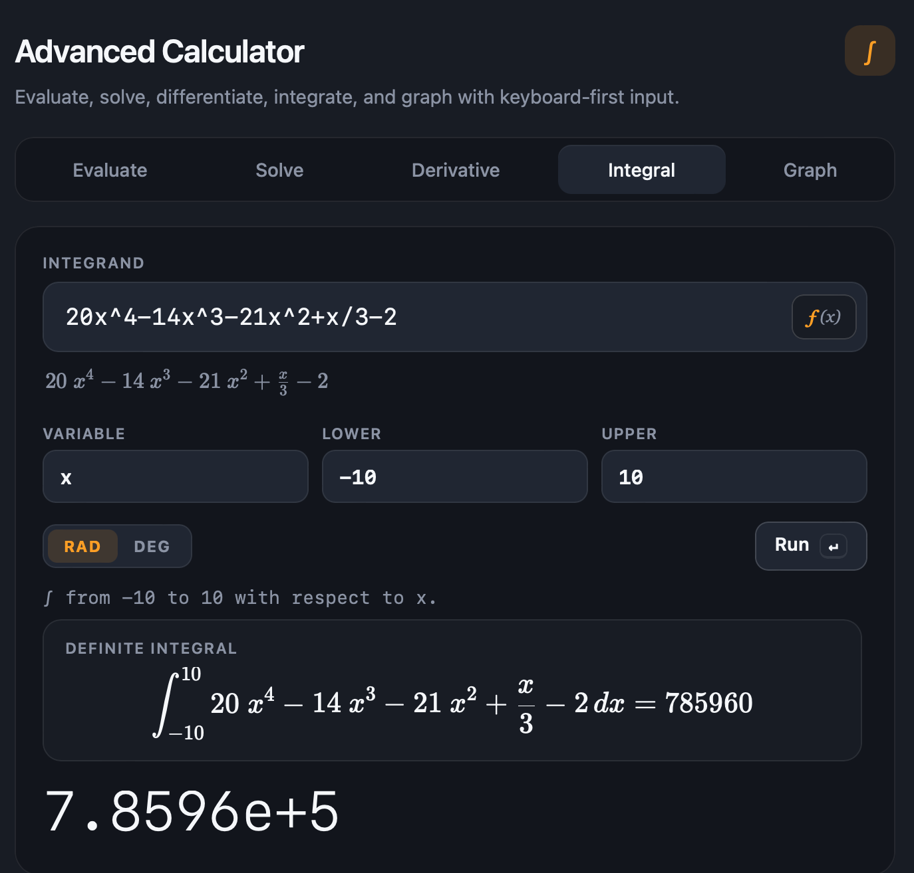
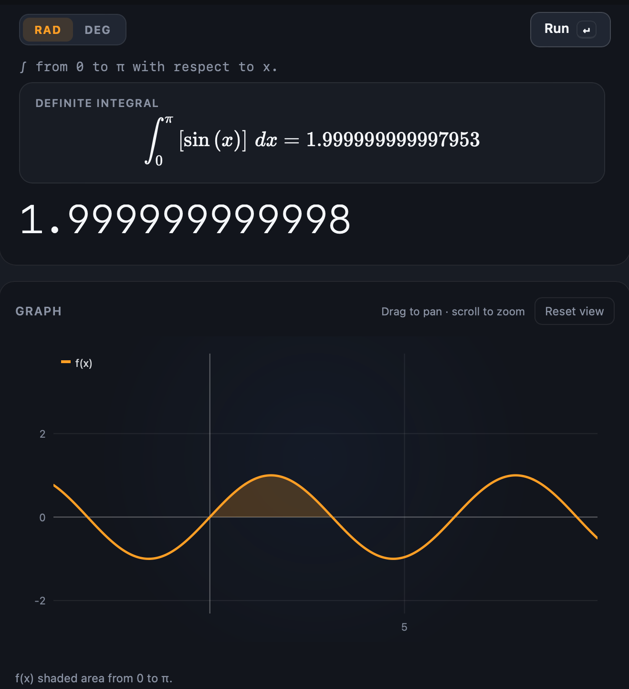

# Advanced Calculator

A keyboard-first browser calculator for evaluating, solving, differentiating, integrating, and graphing functions.

**Live app:** <https://mch2r.github.io/advanced-calculator/>

## Screenshot

| Calculator | Graph workspace |
| --- | --- |
|  |  |

## Features

- Five modes: Evaluate, Solve, Derivative, Integral, and Graph.
- Numeric equation solving for real roots, including multiple roots, trigonometric equations, and asymptote rejection.
- Symbolic derivatives with step traces, derivative orders 1–4, and numeric fallback at a point.
- Definite integration using adaptive Simpson's rule with numeric step details.
- Degree/radian toggle applied across all calculation modes.
- KaTeX-rendered math with plain-text fallbacks.
- Searchable function palette with synonyms and keyboard navigation.
- Graph workspace supporting up to 8 expressions and 50 table rows per expression.
- Parameter sliders, visibility toggles, points of interest, trace readout, and pan/zoom/touch gestures.
- Local storage for calculation history (up to 50 entries) and graph workspace state.
- Keyboard shortcuts for running calculations, switching modes, opening the palette, and controlling the graph.
- Responsive dark layout with labeled controls and keyboard navigation for modes, the palette, and the graph.
- Installable PWA with a web app manifest, install button, icons, and offline app-shell caching.
- Content Security Policy and `no-referrer` protection.

## Examples

- Evaluate `2 + 3 * 4` → `14`
- Evaluate `tan(pi/4)` → `1`
- Solve `x^3 - x = 0` → `x = -1, 0, 1`
- Differentiate `x^3` → `3x^2`
- Integrate `x^2` from `0` to `1` → `1/3`
- Graph `f(x) = x^2 + 1`

## Run Locally

The app is static and requires no build step.

1. Serve the project directory over HTTP:

   ```sh
   python3 -m http.server 8000
   ```

2. Open <http://localhost:8000/>.

Use a local server rather than opening `index.html` directly so the service worker can register. PWA features require `localhost` or HTTPS.

## Install as a PWA

1. Open the [live app](https://mch2r.github.io/advanced-calculator/) or the local server URL in a supported browser.
2. Use the in-app **Install** button when it appears.
3. Alternatively:
   - **Chrome/Edge:** use the install icon in the address bar or the browser menu.
   - **Android:** choose **Install app** or **Add to Home screen** from the browser menu.
   - **iOS Safari:** choose **Share → Add to Home Screen**.
4. Launch it from the home screen or app launcher.

The first load must be online; after that, the cached app shell is available offline. Installation requires HTTPS or localhost.

## Run the Tests

The suite uses the JavaScriptCore harness and has no package-manager dependencies. The test command below is macOS-only.

On macOS:

```sh
JSC=/System/Library/Frameworks/JavaScriptCore.framework/Versions/Current/Helpers/jsc
"$JSC" run-tests.jsc.js
```

Current baseline: all tests pass.

## Privacy

History and graph state are stored only in your browser (localStorage) and never sent anywhere.

## License

MIT — see [LICENSE](LICENSE).
